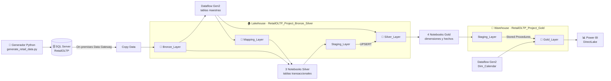
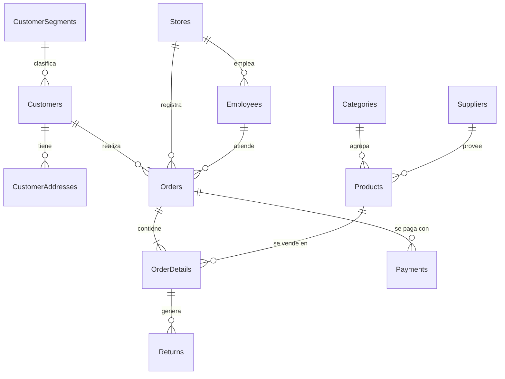
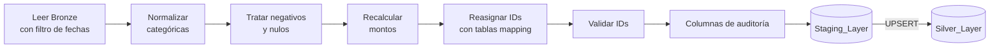
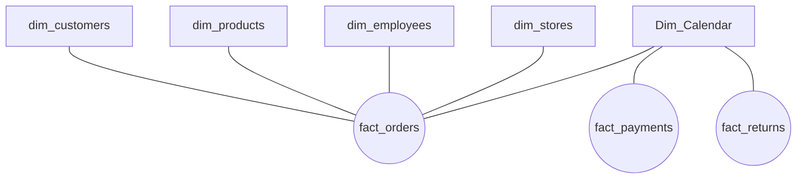
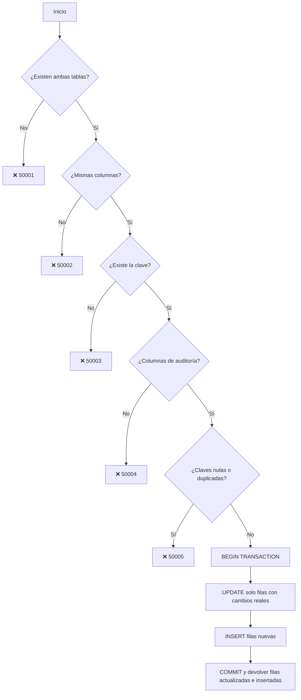

<div align="center">

# 🛒 RetailOLTP → Microsoft Fabric

### Pipeline de datos end-to-end con arquitectura medallón y modelo dimensional

![Microsoft Fabric][badge-fabric]
![SQL Server][badge-sqlserver]
![Python][badge-python]
![PySpark][badge-pyspark]
![T-SQL][badge-tsql]
![Power Query M][badge-m]
![Power BI][badge-powerbi]
![GitHub][badge-github]

</div>

> **En una frase:** datos transaccionales "sucios" de una empresa retail ficticia viajan desde un **SQL Server local** hasta un **modelo estrella en Microsoft Fabric**. En el camino se ingieren, limpian, estandarizan, enriquecen y modelan a través de las capas **Bronze → Silver → Gold**, con cargas incrementales parametrizadas, UPSERTs validados y ejecución diaria automatizada.

---

## Tabla de contenidos

1. [Resumen del proyecto][toc-1]
2. [Arquitectura][toc-2]
3. [Stack tecnológico][toc-3]
4. [Origen: base de datos RetailOLTP][toc-4]
5. [Generador de datos con inconsistencias][toc-5]
6. [Configuración del entorno en Fabric][toc-6]
7. [Capa Bronze: ingesta][toc-7]
8. [Capa Silver: limpieza y estandarización][toc-8]
9. [Capa Gold: modelo dimensional][toc-9]
10. [UPSERT con procedimientos almacenados][toc-10]
11. [Orquestación y programación][toc-11]
12. [Consumo en Power BI (DirectLake)][toc-12]
13. [Decisiones de diseño][toc-13]
14. [Cómo reproducir el proyecto][toc-14]
15. [Estructura del repositorio][toc-15]
16. [Limitaciones y próximos pasos][toc-16]
17. [Autor][toc-17]

---

## Resumen del proyecto

| | |
|---|---|
| 🎯 **Objetivo** | Trasladar datos transaccionales a un entorno analítico confiable que se actualice automáticamente. |
| 🧩 **Reto** | Alrededor del 10 % de los registros de origen tiene errores intencionales: formatos mixtos, idiomas mezclados, nulos, duplicados, montos incoherentes y fechas imposibles. |
| 🏗️ **Solución** | Pipeline en Microsoft Fabric con arquitectura medallón: **Lakehouse** para Bronze y Silver, **Warehouse** para Gold. |
| ✅ **Resultado** | Modelo estrella con **5 dimensiones y 3 hechos**, actualizado a diario y consumible desde Power BI en modo **DirectLake**. |

**Cifras clave del diseño**

| 11 | 3 | 5 + 3 | 2 | 1 |
|:---:|:---:|:---:|:---:|:---:|
| tablas en el origen OLTP | capas medallón | dimensiones + hechos | procedimientos UPSERT genéricos | pipeline orquestador |

---

## Arquitectura



---

## Stack tecnológico

| Capa | Herramienta | Uso en el proyecto |
|---|---|---|
| Origen | **SQL Server** | Base transaccional `RetailOLTP` (11 tablas) |
| Simulación | **Python** (Faker, pyodbc, python-dotenv) | Generación e inserción de datos con errores intencionales |
| Conectividad | **On-premises Data Gateway** | Puente seguro entre SQL Server local y Fabric |
| Ingesta | **Fabric Data Pipeline** (Copy Data) | Carga a Bronze con escritura tipo merge |
| Limpieza de maestros | **Dataflow Gen2** (Power Query M) | Estandarización, deduplicación y tablas de mapeo |
| Limpieza de transacciones | **Fabric Notebooks** (PySpark) | Limpieza, recálculo de montos y UPSERT a Silver |
| Almacenamiento Bronze/Silver | **Lakehouse** (Delta) | Esquemas `Bronze_Layer`, `Mapping_Layer`, `Staging_Layer` y `Silver_Layer` |
| Almacenamiento Gold | **Warehouse** (T-SQL) | Esquemas `Staging_Layer` y `Gold_Layer` |
| Carga final | **Stored Procedures** | UPSERT genérico y validado |
| Consumo | **Power BI** (DirectLake) | Lectura directa del modelo Gold |
| Versionado | **Git integration** de Fabric + GitHub | Control de versiones del workspace |

---

## Origen: base de datos RetailOLTP

Base transaccional normalizada, con claves primarias `IDENTITY`, claves foráneas y `bigint` en las tablas de alto volumen.



| Tipo | Tablas |
|---|---|
| **Maestras** | Categories · Suppliers · Products · CustomerSegments · Customers · CustomerAddresses · Stores · Employees |
| **Transaccionales** | Orders · OrderDetails · Payments · Returns |

📄 Script completo: [`sql/oltp/RetailOLTP_DDL.sql`][file-ddl]

---

## Generador de datos con inconsistencias

[`generator/generate_retail_data.py`][file-generator] simula la operación diaria del negocio y **ensucia a propósito alrededor del 10 % de los registros** para poner a prueba la capa de limpieza.

### Modos de ejecución

| Modo | Qué hace |
|---|---|
| `generate` | Inserta datos maestros (segmentos, categorías, proveedores, clientes, direcciones, tiendas, empleados, productos) y transacciones (pedidos, detalles, pagos, devoluciones) |
| `update` | Modifica registros existentes: email, teléfono, estado y segmento de clientes; direcciones; precio, categoría y estado de productos; estado de pedidos y cantidades de detalles |
| `generate-and-update` | Ejecuta ambos |

### Parámetros

| Parámetro | Valor por defecto |
|---|---|
| `--orders` | 10 000 |
| `--customers` | 1 000 |
| `--products` | 500 |
| `--suppliers` | 30 |
| `--stores` | 15 |
| `--employees` | 100 |
| `--updates` | 100 |

### Lógica de negocio simulada

- Productos con nombre por categoría y variante (`Laptop Pro 0001`) y SKU con prefijo de categoría (`SKU-COM-000001`).
- Pedidos de 1 a 5 productos, con descuentos de 0 %, 5 %, 10 % o 15 %, **IGV de 18 %** y costo de envío.
- El empleado asignado pertenece a la tienda del pedido, y los pedidos son posteriores al registro del cliente.
- Pagos registrados entre 1 minuto y 24 horas después del pedido; devoluciones entre 1 y 60 días después.
- Ciudades y departamentos del Perú.
- Toda la generación se ejecuta en una transacción con `commit` y `rollback`.

<details>
<summary><b>🔍 Catálogo completo de inconsistencias simuladas</b></summary>

<br>

| Entidad | Inconsistencias introducidas |
|---|---|
| **Categories** | MAYÚSCULAS, minúsculas, espacios iniciales, traducción (`Electrónica`) |
| **Suppliers** | Texto con espacios o mayúsculas, emails sin `@` o sin `.`, teléfonos mal formados, país (`PE`, `Perú`, `peru`, `Per`) |
| **Customers** | Género (`M`, `Male`, `Hombre`, `X`, `N/A`, vacío), email, teléfono, estado (`A`, `ACTIVO`, `Inactivo`…), fecha de registro o de nacimiento nula |
| **CustomerAddresses** | Tipo de dirección (`Casa`, `Domicilio`, `WORK`…), ciudad con formato sucio, país, código postal nulo |
| **Stores** | Tipo de tienda y estado no estandarizados |
| **Employees** | Estado no estandarizado |
| **Products** | SKU con formatos distintos, **precio nulo**, **costo mayor al precio de venta**, estado |
| **Orders** | Estado, **pedido anterior al registro del cliente**, total, subtotal y descuento alterados, envío nulo, **empleado de otra tienda** |
| **OrderDetails** | **Cantidades negativas**, descuentos de **110 %, 150 % o −10 %**, total de línea y precio unitario alterados, descuento nulo |
| **Payments** | Método (`Tarjeta`, `CARD`, `Efectivo`…), estado (`P`, `PAGADO`…), **pago anterior al pedido**, monto distinto al total |
| **Returns** | **Devolución anterior al pedido**, **cantidad devuelta mayor a la vendida**, reembolso inflado, estado |

Además, cada ejecución de `generate` vuelve a insertar los catálogos maestros. Eso genera **duplicados por columnas de negocio con IDs distintos**, que la capa Silver debe consolidar.

</details>

---

## Configuración del entorno en Fabric

1. **Workspace `RetailOLTP_Project`** conectado a GitHub desde el inicio para tener control de versiones.

   ![Integración del workspace con GitHub][img-01-1]

   ![Repositorio conectado][img-01-2]

2. **Lakehouse `RetailOLTP_Project_Bronze_Silver`**, que contiene las capas Bronze y Silver.

   ![Lakehouse Bronze/Silver][img-02]

3. **Pipeline orquestador**, que contiene todo el flujo de los datos.

   ![Creación del pipeline][img-03]

---

## Capa Bronze: ingesta

![Actividad Copy Data][img-04-01]

- **Conectividad:** se instaló un **On-premises Data Gateway** que apunta a SQL Server.
- **Actividad Copy Data:**
  - **Origen:** todas las tablas de negocio de `RetailOLTP`, a través del Gateway.
  - **Destino:** esquema `Bronze_Layer` del Lakehouse.
  - **Lectura:** carga incremental. Como el origen no tiene columnas de fecha de actualización, se leen las tablas completas.
  - **Escritura:** **merge**, con las columnas de fusión definidas para cada tabla.
  - **Mapeo:** asignación explícita de columnas de origen a destino.

<details>
<summary>📸 Ver configuración completa de Copy Data</summary>

<br>

![Copy Data 02][img-04-02]

![Copy Data 03][img-04-03]

![Copy Data 04][img-04-04]

![Copy Data 05][img-04-05]

![Copy Data 06][img-04-06]

![Copy Data 07][img-04-07]

![Copy Data 08][img-04-08]

![Copy Data 09][img-04-09]

![Copy Data 10][img-04-10]

</details>

---

## Capa Silver: limpieza y estandarización

La capa Silver trata las tablas de forma distinta según su tipo.

### 1️⃣ Tablas maestras → Dataflow Gen2

![Dataflow Gen2 Silver][img-05]

**Entidades:** Categories, Suppliers, Products, CustomerSegments, Customers, CustomerAddresses, Stores y Employees.

| Paso | Descripción |
|---|---|
| Limpieza | Datos inconsistentes, nulos y formatos |
| **Deduplicación** | Por la **combinación de columnas de negocio**, no por ID |
| Nuevos IDs | Se genera una nueva columna ID por entidad |
| **Tablas de mapeo** | Relación `ID antiguo → ID nuevo` para no perder la integridad referencial |
| Salida | Tablas `*_silver` en `Silver_Layer` |
| Mapeos exportados | `products_mapping`, `customers_mapping`, `stores_mapping` y `employees_mapping` en `Mapping_Layer` |

> 💡 **Por qué hacen falta los mapeos:** si dos registros duplicados (`ID 3` y `ID 57`) se consolidan en uno (`ID 3`), los pedidos que apuntaban al `57` deben reasignarse. Las tablas `*_mapping` permiten hacerlo en las tablas transaccionales.

### 2️⃣ Tablas transaccionales → 3 Notebooks PySpark

Se separaron según **volumen, variedad y velocidad**:

| Notebook | Tablas | Filtro temporal |
|---|---|---|
| `RetailOLTP_Silver_Ingestion_Orders_and_OrderDetails` | Orders, OrderDetails | `OrderDate`. Los detalles se filtran por los `OrderID` seleccionados; por eso ambas tablas comparten notebook |
| `RetailOLTP_Silver_Ingestion_Payments` | Payments | `PaymentDate` |
| `RetailOLTP_Silver_Ingestion_Returns` | Returns | `ReturnDate` |

**Parámetros de cada notebook** (celda de parámetros):

| Parámetro | Valores | Comportamiento |
|---|---|---|
| `MODO_CARGA` | `RANGO` (por defecto) / `FULL` | `FULL` procesa todo el histórico |
| `FECHA_INICIO` | vacío por defecto | Inicio del rango |
| `FECHA_FIN` | vacío por defecto | Fin del rango |

> Con `RANGO` y sin fechas se procesan los **últimos 30 días**.

**Flujo dentro de cada notebook:**



**Columnas de auditoría:** `CreatedAt`, `UpdatedAt`, `SourceSystem`, `BatchID`.

**Comportamiento del UPSERT:** inserta los registros nuevos; en los modificados actualiza los valores, junto con `UpdatedAt` y `BatchID`.

![Notebooks Silver en el pipeline][img-06-01]

<details>
<summary>📸 Ver notebooks de Silver</summary>

<br>

![Notebooks Silver 02][img-06-02]

![Notebooks Silver 03][img-06-03]

![Notebooks Silver 04][img-06-04]

![Notebooks Silver 05][img-06-05]

![Notebooks Silver 06][img-06-06]

</details>

---

## Capa Gold: modelo dimensional

### Esquema estrella

![Modelo estrella][img-07]



### Dimensiones

| Dimensión | Origen Silver | Construcción |
|---|---|---|
| `dim_customers` | Customers + CustomerAddresses + CustomerSegments | Notebook |
| `dim_products` | Products + Suppliers + Categories | Notebook |
| `dim_employees` | Employees | Notebook |
| `dim_stores` | Stores | Notebook |
| `Dim_Calendar` | Generada | **Dataflow Gen2 (M)**: `date`, `day_num`, `day_name`, `week`, `iso_week`, `iso_year`, `month`, `month_name`, `quarter`, `year` |

### Hechos

| Hecho | Origen Silver | Grano | Clave |
|---|---|---|---|
| `fact_orders` | Orders + OrderDetails | Línea de pedido | `OrderID` + `OrderDetailID` |
| `fact_payments` | Payments | Pago | `PaymentID` |
| `fact_returns` | Returns | Devolución | `ReturnID` |

### Warehouse

Para Gold se eligió un **Warehouse** (`RetailOLTP_Project_Gold`), la mejor opción para datos estructurados y dimensionales. Tiene dos esquemas: `Staging_Layer` y `Gold_Layer`.

![Warehouse Gold][img-08]

### Dim_Calendar con Dataflow Gen2

Se construyó con lenguaje M y la interfaz gráfica, y se añadió al pipeline con una actividad de flujo de datos.

![Dataflow Dim_Calendar][img-09-1]

![Dim_Calendar en el pipeline][img-09-2]

### Notebooks de Gold

Hay **4 notebooks**: uno para las dimensiones y uno por cada hecho. Los notebooks de hechos reciben los mismos parámetros `MODO_CARGA`, `FECHA_INICIO` y `FECHA_FIN`.

- Selección de columnas y joins, con **broadcast join** para tablas pequeñas como Categories y CustomerSegments.
- Agregaciones con **funciones de ventana**.
- Columnas derivadas, como componentes de hora.
- **Prorrateo de `ShippingAmount`** entre las líneas de cada pedido, para no contar el envío varias veces.
- Columnas de auditoría `CreatedAt`, `UpdatedAt` y `BatchID`.
- Escritura en `Staging_Layer` con sufijo `_staging` (por ejemplo, `fact_orders_staging`).
- Creación de la tabla destino en `Gold_Layer` si aún no existe.

<details>
<summary>📸 Ver notebooks de Gold</summary>

<br>

![Notebooks Gold 01][img-10-1]

![Notebooks Gold 02][img-10-2]

![Notebooks Gold 03][img-10-3]

![Notebooks Gold 04][img-10-4]

</details>

---

## UPSERT con procedimientos almacenados

La carga de Staging a Gold usa **dos procedimientos genéricos con SQL dinámico**, reutilizados por todas las tablas.

| Procedimiento | Uso |
|---|---|
| `usp_upsert_una_clave` | Tablas con clave simple: dimensiones, `fact_payments` y `fact_returns` |
| `usp_upsert_dos_claves` | Tablas con clave compuesta: `fact_orders` |

### Flujo y validaciones



| Código | Error |
|:---:|---|
| `50001` | No se encontraron columnas para la tabla destino o staging |
| `50002` | Las columnas no coinciden entre staging y destino |
| `50003` | No existe la clave indicada en el destino |
| `50004` | Faltan columnas de auditoría (`CreatedAt`, `UpdatedAt`, `BatchID`) |
| `50005` | Claves nulas o duplicadas en staging |

**Detalles de implementación:**

- La detección de cambios compara cada columna de negocio y **contempla los valores `NULL`**.
- `CreatedAt` nunca se sobrescribe; `UpdatedAt` y `BatchID` se toman de staging.
- Todo ocurre dentro de una transacción con `TRY/CATCH` y `ROLLBACK`.
- El procedimiento devuelve cuántas filas actualizó y cuántas insertó.

**Procedimientos ejecutores** (los que llama el pipeline):

```sql
-- Dimensiones
EXEC [Gold_Layer].[usp_upsert_dimensiones];
-- Internamente:
--   usp_upsert_una_clave 'dim_customers', 'CustomerID'
--   usp_upsert_una_clave 'dim_employees', 'EmployeeID'
--   usp_upsert_una_clave 'dim_products',  'ProductID'
--   usp_upsert_una_clave 'dim_stores',    'StoreID'

-- Hechos
EXEC [Gold_Layer].[usp_upsert_fact_orders];    -- dos claves: OrderID + OrderDetailID
EXEC [Gold_Layer].[usp_upsert_fact_payments];  -- una clave: PaymentID
EXEC [Gold_Layer].[usp_upsert_fact_returns];   -- una clave: ReturnID
```

📄 Código completo: [`sql/warehouse/`][file-warehouse]

<details>
<summary>📸 Ver procedimientos en el Warehouse</summary>

<br>

![Procedimientos 01][img-11-1]

![Procedimientos 02][img-11-2]

![Procedimientos 03][img-11-3]

![Procedimientos 04][img-11-4]

![Procedimientos 05][img-11-5]

![Procedimientos 06][img-11-6]

</details>

---

## Orquestación y programación

![Pipeline completo][img-12]

### Etapas del pipeline

| # | Etapa | Actividad |
|:---:|---|---|
| 1 | Bronze | Copy Data (SQL Server → Lakehouse) |
| 2 | Silver: maestros | Dataflow Gen2 |
| 3 | Silver: transacciones | 3 notebooks |
| 4 | Gold: calendario | Dataflow Gen2 |
| 5 | Gold: dimensiones | Notebook + `usp_upsert_dimensiones` |
| 6 | Gold: hechos | 3 notebooks + `usp_upsert_fact_*` |

### Parámetros centralizados

Se definen **una sola vez** a nivel de pipeline y se pasan a cada notebook que los usa:

| Parámetro del pipeline | Se pasa a |
|---|---|
| `modo_carga` | `MODO_CARGA` |
| `fecha_inicio` | `FECHA_INICIO` |
| `fecha_fin` | `FECHA_FIN` |

![Parámetros del pipeline][img-13-1]

<details>
<summary>📸 Ver paso de parámetros a los notebooks</summary>

<br>

![Parámetros 02][img-13-2]

![Parámetros 03][img-13-3]

![Parámetros 04][img-13-4]

</details>

### Políticas de ejecución

| Configuración | Valor |
|---|---|
| ⏱️ Tiempo máximo por actividad | 40 minutos |
| 🔁 Reintentos | 1, tras 30 minutos |
| 📅 Programación | Diaria a las **3:00 a. m.** |
| ⚙️ Parámetros programados | `modo_carga = RANGO`, sin fechas (últimos 30 días) |

![Programación diaria][img-14-1]

![Parámetros de la programación][img-14-2]

### Resultado final

| Pipeline | Workspace |
|:---:|:---:|
| ![Pipeline final][img-15] | ![Workspace final][img-16] |

---

## Consumo en Power BI (DirectLake)

Se creó un reporte conectado al Warehouse Gold en modo **DirectLake** para validar la conexión, y funcionó correctamente.

![Power BI DirectLake][img-17]

**Ventaja de DirectLake:** consulta directamente las tablas Delta, sin importar copias de los datos ni programar actualizaciones del modelo semántico.

---

## Decisiones de diseño

| Decisión | Motivo |
|---|---|
| **Lakehouse para Bronze/Silver, Warehouse para Gold** | Spark y archivos Delta para una limpieza flexible; T-SQL y esquemas estructurados para el modelo dimensional |
| **Dataflow Gen2 para maestros, notebooks para transacciones** | Los maestros son pocos y se benefician de la interfaz visual; las transacciones tienen más volumen y una lógica más compleja |
| **Deduplicación por columnas de negocio + tablas de mapeo** | Consolida duplicados con distinto ID sin romper la integridad referencial |
| **Staging + UPSERT en Silver y en Gold** | Cargas idempotentes: solo inserta lo nuevo y actualiza lo que realmente cambió |
| **Procedimientos genéricos** | Un solo código para todas las tablas, con validaciones centralizadas |
| **Prorrateo del envío por línea** | Evita duplicar `ShippingAmount` al pasar al grano de línea de pedido |
| **Parámetros a nivel de pipeline** | Una sola configuración para cargas por rango o completas |
| **Integración con Git desde el inicio** | Trazabilidad de todos los artefactos de Fabric |

---

## Cómo reproducir el proyecto

### Requisitos

- SQL Server y ODBC Driver 18 for SQL Server
- Python 3.10 o superior
- Capacidad de Microsoft Fabric (prueba o de pago)
- On-premises Data Gateway

### 1. Crear la base de datos origen

Ejecuta [`sql/oltp/RetailOLTP_DDL.sql`][file-ddl] en SQL Server.

### 2. Configurar y ejecutar el generador

```bash
pip install pyodbc faker python-dotenv
```

Crea un archivo `.env`:

```env
SQL_SERVER=localhost
SQL_DATABASE=RetailOLTP
SQL_DRIVER=ODBC Driver 18 for SQL Server
```

```bash
# Carga inicial
python generator/generate_retail_data.py --mode generate

# Simular cambios en datos existentes
python generator/generate_retail_data.py --mode update --updates 100

# Ambos, con volúmenes personalizados
python generator/generate_retail_data.py --mode generate-and-update --orders 20000 --customers 2000
```

### 3. Configurar Microsoft Fabric

1. Crea un workspace y conéctalo a este repositorio (**Workspace settings → Git integration**).
2. Instala y configura el **On-premises Data Gateway** apuntando a SQL Server.
3. Sincroniza los artefactos del repositorio con el workspace.
4. Crea en el Warehouse los procedimientos de [`sql/warehouse/`][file-warehouse].
5. Ejecuta el pipeline con `modo_carga = FULL` para la carga inicial.
6. Activa la programación diaria.

---

## Estructura del repositorio

```text
RetailOLTP-Project-Fabric/
├── generator/
│   └── generate_retail_data.py
├── sql/
│   ├── oltp/
│   │   └── RetailOLTP_DDL.sql
│   └── warehouse/
│       ├── usp_upsert_una_clave.sql
│       ├── usp_upsert_dos_claves.sql
│       ├── usp_upsert_dimensiones.sql
│       ├── usp_upsert_fact_orders.sql
│       ├── usp_upsert_fact_payments.sql
│       └── usp_upsert_fact_returns.sql
├── fabric/                      # Artefactos sincronizados por Git integration
├── docs/
│   └── images/
├── .env.example
└── README.md
```

---

## Limitaciones y próximos pasos

| Limitación actual | Mejora propuesta |
|---|---|
| El origen no tiene fecha de modificación, así que Bronze lee las tablas completas | Agregar `ModifiedAt` o `rowversion`, o activar **CDC / Change Tracking** en SQL Server |
| El filtro por fecha de negocio no captura cambios en registros antiguos | Filtrar por fecha de ingesta o de modificación |
| Las dimensiones sobrescriben el histórico (SCD tipo 1) | Implementar **SCD tipo 2** en `dim_customers` y `dim_products` |
| Los registros eliminados en el origen no se reflejan en Gold | Agregar *soft delete* o detección de bajas |
| El reporte de Power BI solo valida la conexión | Dashboard con KPIs de ventas, devoluciones y calidad de datos |
| No hay trazabilidad por ejecución | Tabla de log con filas insertadas y actualizadas por `BatchID` |

---

## Autor

**Jean Edinson Guevara Briones**

[![LinkedIn][badge-linkedin]][link-linkedin]
[![GitHub][badge-github-profile]][link-github]

⭐ Si este proyecto te resultó útil, ¡dale una estrella al repositorio!

<!-- ====================== REFERENCIAS ====================== -->

[badge-fabric]: https://img.shields.io/badge/Microsoft%20Fabric-0078D4?style=for-the-badge&logo=microsoft&logoColor=white
[badge-sqlserver]: https://img.shields.io/badge/SQL%20Server-CC2927?style=for-the-badge&logo=microsoftsqlserver&logoColor=white
[badge-python]: https://img.shields.io/badge/Python-3776AB?style=for-the-badge&logo=python&logoColor=white
[badge-pyspark]: https://img.shields.io/badge/PySpark-E25A1C?style=for-the-badge&logo=apachespark&logoColor=white
[badge-tsql]: https://img.shields.io/badge/T--SQL-CC2927?style=for-the-badge&logo=microsoftsqlserver&logoColor=white
[badge-m]: https://img.shields.io/badge/Power%20Query%20M-217346?style=for-the-badge&logo=powerbi&logoColor=white
[badge-powerbi]: https://img.shields.io/badge/Power%20BI-F2C811?style=for-the-badge&logo=powerbi&logoColor=black
[badge-github]: https://img.shields.io/badge/GitHub-181717?style=for-the-badge&logo=github&logoColor=white
[badge-linkedin]: https://img.shields.io/badge/LinkedIn-0A66C2?style=for-the-badge&logo=linkedin&logoColor=white
[badge-github-profile]: https://img.shields.io/badge/GitHub-181717?style=for-the-badge&logo=github&logoColor=white

[link-linkedin]: https://www.linkedin.com/in/TU-USUARIO
[link-github]: https://github.com/TU-USUARIO

[toc-1]: #resumen-del-proyecto
[toc-2]: #arquitectura
[toc-3]: #stack-tecnológico
[toc-4]: #origen-base-de-datos-retailoltp
[toc-5]: #generador-de-datos-con-inconsistencias
[toc-6]: #configuración-del-entorno-en-fabric
[toc-7]: #capa-bronze-ingesta
[toc-8]: #capa-silver-limpieza-y-estandarización
[toc-9]: #capa-gold-modelo-dimensional
[toc-10]: #upsert-con-procedimientos-almacenados
[toc-11]: #orquestación-y-programación
[toc-12]: #consumo-en-power-bi-directlake
[toc-13]: #decisiones-de-diseño
[toc-14]: #cómo-reproducir-el-proyecto
[toc-15]: #estructura-del-repositorio
[toc-16]: #limitaciones-y-próximos-pasos
[toc-17]: #autor

[file-ddl]: sql/oltp/RetailOLTP_DDL.sql
[file-generator]: generator/generate_retail_data.py
[file-warehouse]: sql/warehouse/

[img-01-1]: docs/images/01-workspace-git-1.png
[img-01-2]: docs/images/01-workspace-git-2.png
[img-02]: docs/images/02-lakehouse.png
[img-03]: docs/images/03-pipeline-creacion.png
[img-04-01]: docs/images/04-copy-data-01.png
[img-04-02]: docs/images/04-copy-data-02.png
[img-04-03]: docs/images/04-copy-data-03.png
[img-04-04]: docs/images/04-copy-data-04.png
[img-04-05]: docs/images/04-copy-data-05.png
[img-04-06]: docs/images/04-copy-data-06.png
[img-04-07]: docs/images/04-copy-data-07.png
[img-04-08]: docs/images/04-copy-data-08.png
[img-04-09]: docs/images/04-copy-data-09.png
[img-04-10]: docs/images/04-copy-data-10.png
[img-05]: docs/images/05-dataflow-silver.png
[img-06-01]: docs/images/06-notebooks-silver-01.png
[img-06-02]: docs/images/06-notebooks-silver-02.png
[img-06-03]: docs/images/06-notebooks-silver-03.png
[img-06-04]: docs/images/06-notebooks-silver-04.png
[img-06-05]: docs/images/06-notebooks-silver-05.png
[img-06-06]: docs/images/06-notebooks-silver-06.png
[img-07]: docs/images/07-modelo-estrella.png
[img-08]: docs/images/08-warehouse.png
[img-09-1]: docs/images/09-dim-calendar-1.png
[img-09-2]: docs/images/09-dim-calendar-2.png
[img-10-1]: docs/images/10-notebooks-gold-1.png
[img-10-2]: docs/images/10-notebooks-gold-2.png
[img-10-3]: docs/images/10-notebooks-gold-3.png
[img-10-4]: docs/images/10-notebooks-gold-4.png
[img-11-1]: docs/images/11-procedimientos-1.png
[img-11-2]: docs/images/11-procedimientos-2.png
[img-11-3]: docs/images/11-procedimientos-3.png
[img-11-4]: docs/images/11-procedimientos-4.png
[img-11-5]: docs/images/11-procedimientos-5.png
[img-11-6]: docs/images/11-procedimientos-6.png
[img-12]: docs/images/12-pipeline-completo.png
[img-13-1]: docs/images/13-parametros-1.png
[img-13-2]: docs/images/13-parametros-2.png
[img-13-3]: docs/images/13-parametros-3.png
[img-13-4]: docs/images/13-parametros-4.png
[img-14-1]: docs/images/14-programacion-1.png
[img-14-2]: docs/images/14-programacion-2.png
[img-15]: docs/images/15-pipeline-final.png
[img-16]: docs/images/16-workspace-final.png
[img-17]: docs/images/17-powerbi-directlake.png
