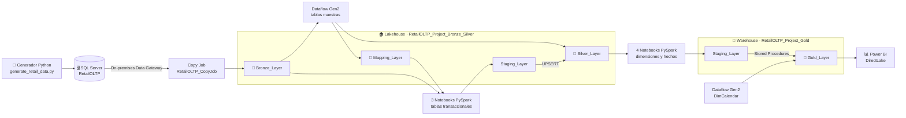
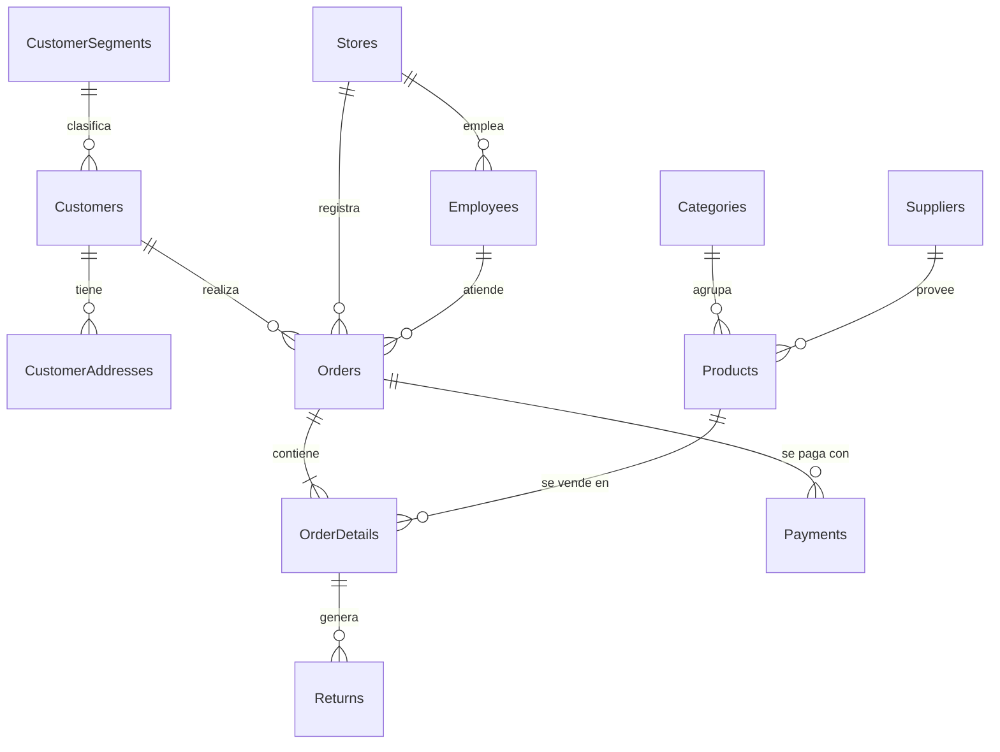
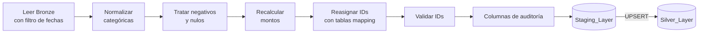
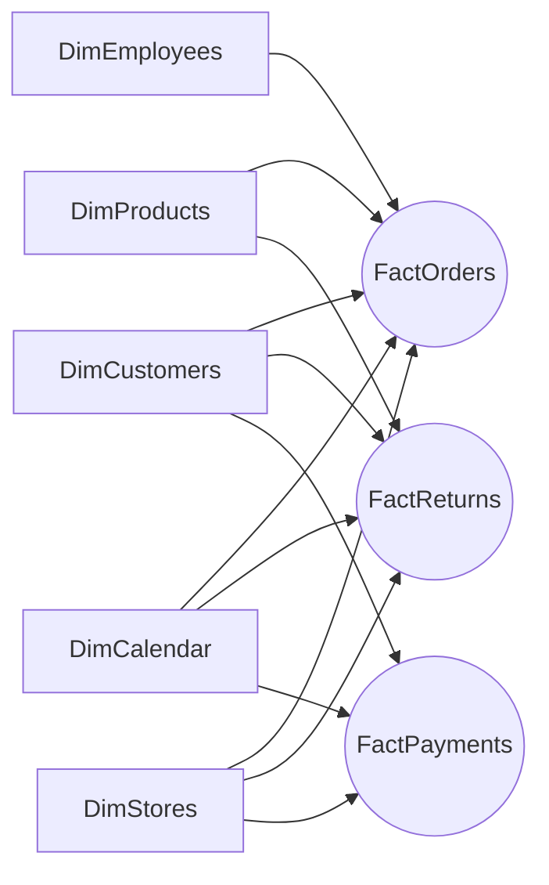
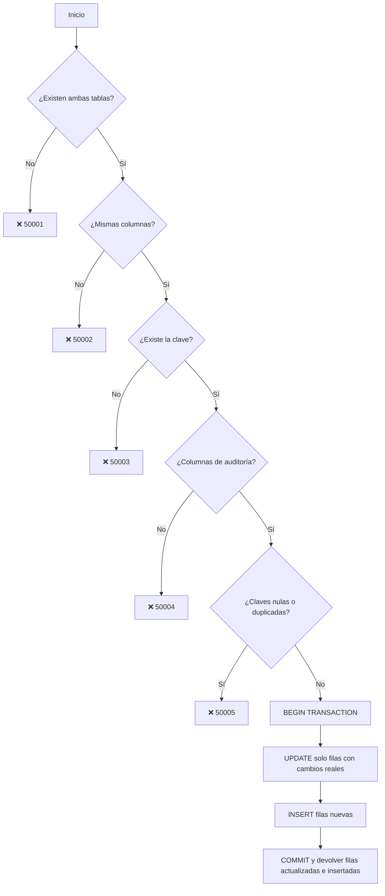

<div align="center">

# 🛒 RetailOLTP → Microsoft Fabric

### Pipeline de datos end-to-end con arquitectura medallón y modelo dimensional

![Microsoft Fabric][badge-fabric]
![SQL Server][badge-sqlserver]
![Python][badge-python]
![PySpark][badge-pyspark]
![T-SQL][badge-tsql]
![Power BI][badge-powerbi]
![GitHub][badge-github]

</div>

> **En una frase:** RetailOLTP, una cadena retail ficticia con 15 tiendas en el Perú, registra su operación en un SQL Server local con datos duplicados, inconsistentes y sin estructura analítica. Este proyecto construye en **Microsoft Fabric** un pipeline automatizado que, cada día, lleva esos datos por las capas **Bronze → Silver → Gold** y los entrega **limpios, integrados y modelados en un esquema estrella** listo para Power BI.

> 📚 Cada sección incluye un bloque desplegable **Fundamento técnico** que explica el porqué de las decisiones tomadas.

---

## Tabla de contenidos

1. [Resumen del proyecto][toc-1]
2. [Arquitectura][toc-2]
3. [Stack tecnológico][toc-3]
4. [Elección de componentes de Fabric][toc-4]
5. [Origen: base de datos RetailOLTP][toc-5]
6. [Generador de datos con inconsistencias][toc-6]
7. [Configuración del entorno en Fabric][toc-7]
8. [Capa Bronze: ingesta][toc-8]
9. [Capa Silver: limpieza y estandarización][toc-9]
10. [Capa Gold: modelo dimensional][toc-10]
11. [UPSERT con procedimientos almacenados][toc-11]
12. [Orquestación y programación][toc-12]
13. [Consumo en Power BI (DirectLake)][toc-13]
14. [Cómo reproducir el proyecto][toc-14]
15. [Estructura del repositorio][toc-15]
16. [Limitaciones y próximos pasos][toc-16]
17. [Autor][toc-17]

---

## Resumen del proyecto

### 🏪 El contexto

**RetailOLTP** es una cadena retail ficticia que opera en el Perú. Vende productos de electrónica, cómputo, telefonía, hogar, cocina, deportes, ropa, belleza, libros y juguetes.

| 15 | 100 | ~1 000 | 500 | 30 |
|:---:|:---:|:---:|:---:|:---:|
| tiendas en 15 ciudades | colaboradores | clientes en 5 segmentos | productos en 10 categorías | proveedores |

Toda la operación (pedidos, líneas de pedido, pagos y devoluciones) se registra en una **base de datos transaccional SQL Server instalada en un servidor local**. Para simular el día a día del negocio, un generador en Python:

- crea pedidos desde 2023, con descuentos, **IGV de 18 %** y costo de envío;
- registra pagos y devoluciones;
- modifica registros existentes, como ocurre en un sistema real: clientes que cambian de segmento, productos que cambian de precio, pedidos que cambian de estado.

### ⚠️ El problema

El negocio quiere analizar sus ventas, devoluciones y pagos, pero los datos no están listos para eso:

| Problema | Cómo se manifiesta |
|---|---|
| 🗄️ **Un sistema diseñado para operar, no para analizar** | El modelo está normalizado en 11 tablas. Cualquier reporte requiere muchos *joins* y compite por recursos con la operación diaria. |
| 🧹 **Datos poco confiables** | Alrededor del 10 % de los registros tiene errores: `Activo`, `ACTIVE` y `A` para el mismo estado; `Electrónica` y `Electronics` como categorías distintas; cantidades negativas; descuentos de 150 %; totales que no cuadran. |
| 👥 **Catálogos duplicados** | El mismo cliente, producto o tienda aparece varias veces con IDs distintos. Los conteos se inflan y las referencias se dispersan. |
| 🔄 **Datos que cambian en el tiempo** | Clientes, productos y pedidos se modifican después de registrarse. Un análisis confiable debe reflejar esos cambios sin duplicar información. |
| 🔒 **Datos aislados** | La información vive en un servidor local, fuera del alcance de herramientas analíticas en la nube. |
| ⏳ **Sin actualización automática** | Cada reporte dependería de extracciones manuales. |

### 💡 La solución

Se construyó una **plataforma analítica en Microsoft Fabric** que, cada día y sin intervención manual, lleva los datos desde el servidor local hasta un modelo listo para Power BI:

| # | Paso | Qué se hace | Problema que resuelve |
|:---:|---|---|---|
| 1 | 🔌 **Conectar** | Un **On-premises Data Gateway** y un **Copy Job** copian el origen en la capa **Bronze** con método merge | Datos aislados, carga sobre el OLTP |
| 2 | 🧹 **Limpiar y unificar** | En la capa **Silver**, **Dataflow Gen2** estandariza los maestros y consolida duplicados con tablas de mapeo de IDs; **notebooks PySpark** limpian las transacciones y recalculan montos | Datos poco confiables, catálogos duplicados |
| 3 | ⭐ **Modelar** | En la capa **Gold**, un **esquema estrella** (5 dimensiones compartidas y 3 hechos) en un Warehouse, cargado con **UPSERTs validados** | Modelo no apto para análisis, datos que cambian |
| 4 | ⚙️ **Automatizar** | Un **pipeline** único con parámetros, reintentos y ejecución diaria a las 3:00 a. m., que reprocesa los últimos 30 días | Sin actualización automática |
| 5 | 📊 **Consumir** | **Power BI en modo DirectLake**, sin copias de datos ni actualizaciones adicionales | Acceso a los datos desde BI |

### 🔁 Antes y después

| | Antes | Después |
|---|---|---|
| **Ubicación** | Servidor SQL Server local | OneLake (Microsoft Fabric) |
| **Calidad** | ~10 % de registros con errores | Valores estandarizados y montos coherentes |
| **Duplicados** | Mismo registro con varios IDs | Registros consolidados con integridad referencial |
| **Modelo** | 11 tablas normalizadas (OLTP) | Esquema estrella: 5 dimensiones + 3 hechos |
| **Cambios** | Sin trazabilidad | UPSERT con `CreatedAt`, `UpdatedAt` y `BatchID` |
| **Actualización** | Manual | Diaria y automática |
| **Consumo** | Consultas SQL sobre el sistema operativo | Power BI con DirectLake |

### 🎯 Preguntas de negocio que el modelo puede responder

- ¿Cuánto vende cada tienda, ciudad y categoría por mes, trimestre o año?
- ¿Qué segmentos de clientes generan más ingresos?
- ¿Qué productos tienen mayor tasa de devolución y por qué motivos?
- ¿Cuál es el margen estimado por producto (precio de venta frente a costo)?
- ¿Qué métodos de pago prefieren los clientes y cuántos pagos quedan pendientes?
- ¿En qué franjas horarias se concentran las ventas?

### 📐 Cifras clave del diseño

| 11 | 3 | 5 + 3 | 2 | 1 |
|:---:|:---:|:---:|:---:|:---:|
| tablas en el origen OLTP | capas medallón | dimensiones + hechos | procedimientos UPSERT genéricos | pipeline orquestador |

---

## Arquitectura



<details>
<summary><b>📚 Fundamento técnico: ¿por qué una arquitectura medallón?</b></summary>

<br>

La **arquitectura medallón** organiza los datos en capas de calidad creciente. Cada capa tiene una única responsabilidad:

| Capa | Responsabilidad | Beneficio |
|---|---|---|
| 🥉 **Bronze** | Copia fiel del origen, sin transformar | Permite **reprocesar** sin volver a consultar el sistema transaccional y sirve como respaldo auditable |
| 🥈 **Silver** | Datos limpios, estandarizados, deduplicados y con integridad referencial | Una **única versión confiable** de cada entidad, reutilizable por cualquier caso de uso |
| 🥇 **Gold** | Datos modelados para el negocio (esquema estrella) | Consultas simples y rápidas para BI |

Separar responsabilidades facilita depurar errores (se sabe en qué capa ocurrió), aísla al sistema OLTP de la carga analítica y permite mejorar la calidad de forma incremental.

</details>

---

## Stack tecnológico

| Capa | Herramienta | Uso en el proyecto |
|---|---|---|
| Origen | **SQL Server** | Base transaccional `RetailOLTP` (11 tablas) |
| Simulación | **Python** (Faker, pyodbc, python-dotenv) | Generación e inserción de datos con errores intencionales |
| Conectividad | **On-premises Data Gateway** | Puente seguro entre SQL Server local y Fabric |
| Ingesta | **Fabric Copy Job** | Copia de las 11 tablas a Bronze con método merge |
| Limpieza de maestros | **Dataflow Gen2** (Power Query M) | Estandarización, deduplicación y tablas de mapeo |
| Limpieza de transacciones | **Fabric Notebooks** (PySpark) | Limpieza, recálculo de montos y UPSERT a Silver |
| Modelado Gold | **Fabric Notebooks** (PySpark) | Construcción de dimensiones y hechos |
| Almacenamiento Bronze/Silver | **Lakehouse** (Delta Lake) | Esquemas `Bronze_Layer`, `Mapping_Layer`, `Staging_Layer` y `Silver_Layer` |
| Almacenamiento Gold | **Warehouse** (T-SQL) | Esquemas `Staging_Layer` y `Gold_Layer` |
| Carga final | **Stored Procedures** | UPSERT genérico y validado |
| Orquestación | **Fabric Data Pipeline** | Ejecución ordenada de todas las etapas, parámetros, reintentos y programación diaria |
| Consumo | **Power BI** (DirectLake) | Lectura directa del modelo Gold |
| Versionado | **Git integration** de Fabric + GitHub | Control de versiones del workspace |

---

## Elección de componentes de Fabric

| Necesidad | Componente elegido | Alternativa descartada | Por qué |
|---|---|---|---|
| Almacenar Bronze y Silver | **Lakehouse** | Warehouse | Spark y Delta Lake permiten transformaciones flexibles y a escala, con esquemas que pueden evolucionar. Es el entorno natural de la ingeniería de datos. |
| Almacenar Gold | **Warehouse** | Lakehouse | Ofrece T-SQL completo con escritura, transacciones ACID y **procedimientos almacenados**. El endpoint SQL del Lakehouse es de **solo lectura**, así que no permite UPSERTs con T-SQL. |
| Ingestar desde SQL Server local | **Copy Job + Gateway** | Actividad Copy Data / Notebook con JDBC | Copia varias tablas en un solo elemento, con carga incremental y método merge integrados y sin código. El Gateway resuelve la conexión segura con la red local. |
| Limpiar tablas maestras | **Dataflow Gen2** | Notebook | Poco volumen y transformaciones típicas de Power Query (recortar espacios, reemplazar valores, quitar duplicados). Cada paso queda visible y es fácil de mantener. |
| Limpiar tablas transaccionales | **Notebooks PySpark** | Dataflow Gen2 | Mayor volumen y lógica compleja: recálculo de montos, reasignación de IDs y MERGE en Delta. Spark distribuye el procesamiento y el código es parametrizable y versionable. |
| Generar el calendario | **Dataflow Gen2 (M)** | Notebook | Es una tabla generada (no proviene del origen), sencilla de construir con funciones de fecha de M. |
| Orquestar | **Data Pipeline** | Ejecución manual o programación por elemento | Un solo punto de control: dependencias entre actividades, parámetros globales, reintentos, tiempos máximos y programación. |
| Consumir | **Power BI DirectLake** | Import / DirectQuery | Rendimiento similar a Import sin copiar datos ni programar actualizaciones del modelo. |

---

## Origen: base de datos RetailOLTP

Base transaccional normalizada (3FN), con claves primarias `IDENTITY`, claves foráneas y `bigint` en las tablas de alto volumen.



| Tipo | Tablas |
|---|---|
| **Maestras** | Categories · Suppliers · Products · CustomerSegments · Customers · CustomerAddresses · Stores · Employees |
| **Transaccionales** | Orders · OrderDetails · Payments · Returns |

📄 Script completo: [`sql/oltp/RetailOLTP_DDL.sql`][file-ddl]

<details>
<summary><b>📚 Fundamento técnico: ¿por qué no analizar directamente sobre el OLTP?</b></summary>

<br>

Un sistema **OLTP** está optimizado para muchas transacciones pequeñas (insertar un pedido, actualizar un estado). Por eso está **normalizado**: evita redundancias, pero cualquier análisis requiere muchos *joins*. Las consultas analíticas, en cambio, recorren grandes volúmenes. Ejecutarlas sobre el OLTP compite por recursos con la operación del negocio y obliga a escribir consultas complejas.

Por eso los datos se trasladan a un entorno **OLAP** separado y se remodelan en un esquema estrella orientado al análisis.

</details>

---

## Generador de datos con inconsistencias

[`generator/generate_retail_data.py`][file-generator] simula la operación diaria del negocio y **ensucia a propósito alrededor del 10 % de los registros** para poner a prueba la capa de limpieza.

### Modos de ejecución

| Modo | Qué hace |
|---|---|
| `generate` | Inserta datos maestros (segmentos, categorías, proveedores, clientes, direcciones, tiendas, empleados, productos) y transacciones (pedidos, detalles, pagos, devoluciones) |
| `update` | Modifica registros existentes: email, teléfono, estado y segmento de clientes; direcciones; precio, categoría y estado de productos; estado de pedidos y cantidades de detalles |
| `generate-and-update` | Ejecuta ambos |

### Parámetros

| Parámetro | Valor por defecto |
|---|---|
| `--orders` | 10 000 |
| `--customers` | 1 000 |
| `--products` | 500 |
| `--suppliers` | 30 |
| `--stores` | 15 |
| `--employees` | 100 |
| `--updates` | 100 |

### Lógica de negocio simulada

- Productos con nombre por categoría y variante (`Laptop Pro 0001`) y SKU con prefijo de categoría (`SKU-COM-000001`).
- Pedidos de 1 a 5 productos, con descuentos de 0 %, 5 %, 10 % o 15 %, **IGV de 18 %** y costo de envío.
- El empleado asignado pertenece a la tienda del pedido, y los pedidos son posteriores al registro del cliente.
- Pagos registrados entre 1 minuto y 24 horas después del pedido; devoluciones entre 1 y 60 días después.
- Ciudades y departamentos del Perú.
- Toda la generación se ejecuta en una transacción con `commit` y `rollback`.

<details>
<summary><b>📚 Fundamento técnico: ¿por qué generar datos sucios a propósito?</b></summary>

<br>

En entornos reales, los problemas de calidad de datos son la norma: sistemas que capturan texto libre, integraciones en varios idiomas, errores de digitación y procesos que reinsertan catálogos. Un pipeline que solo se prueba con datos perfectos no demuestra nada.

Al controlar qué errores existen y en qué proporción, cada regla de limpieza de Silver tiene un caso de prueba concreto. El modo `update` simula, además, que el origen **cambia en el tiempo**, lo que obliga a diseñar cargas que actualicen registros y no solo inserten.

</details>

---

## Configuración del entorno en Fabric

1. **Workspace `RetailOLTP_Project`** conectado a GitHub desde el inicio.

   ![Integración del workspace con GitHub][img-01-1]

2. **Lakehouse `RetailOLTP_Project_Bronze_Silver`**, que contiene las capas Bronze y Silver.

   ![Lakehouse Bronze/Silver][img-02]

3. **Pipeline `RetailOLTP_Project_Pipeline`**, que orquesta todo el flujo de los datos.

   ![Creación del pipeline][img-03]

<details>
<summary><b>📚 Fundamento técnico: ¿por qué integrar Git desde el inicio?</b></summary>

<br>

La integración de Fabric con Git guarda la definición de cada elemento (pipelines, Copy Jobs, notebooks, dataflows, lakehouse, warehouse) como archivos en el repositorio. Esto permite:

- **Historial y trazabilidad:** quién cambió qué y cuándo.
- **Reversión:** volver a una versión estable si un cambio rompe el pipeline.
- **Trabajo por ramas:** desarrollar cambios sin afectar la versión productiva.
- **Base para CI/CD:** promover cambios entre entornos (desarrollo → producción).

Configurarlo antes de desarrollar asegura que **todo** el proyecto quede versionado desde el primer elemento.

</details>

---

## Capa Bronze: ingesta

![Copy Job][img-04-01]

- **Conectividad:** se instaló un **On-premises Data Gateway** que apunta a SQL Server.
- **Copy Job `RetailOLTP_CopyJob`**, ejecutado desde el pipeline:
  - **Origen:** las 11 tablas de negocio de `RetailOLTP`, a través del Gateway.
  - **Destino:** esquema `Bronze_Layer` del Lakehouse.
  - **Modo de copia:** incremental. Como el origen no tiene columnas de fecha de actualización, se configuró para leer las tablas completas en cada ejecución.
  - **Método de actualización:** **merge (combinar)**, con las columnas clave definidas para cada tabla.
  - **Mapeo:** asignación explícita de columnas de origen a destino.

<details>
<summary>📸 Ver configuración completa del Copy Job</summary>

<br>

![Copy Job 02][img-04-02]

![Copy Job 03][img-04-03]

![Copy Job 04][img-04-04]

![Copy Job 05][img-04-05]

![Copy Job 06][img-04-06]

![Copy Job 07][img-04-07]

![Copy Job 08][img-04-08]

![Copy Job 09][img-04-09]

</details>

<details>
<summary><b>📚 Fundamento técnico: Gateway, Copy Job, método merge y lectura completa</b></summary>

<br>

**¿Por qué un On-premises Data Gateway?**
Fabric es un servicio en la nube y SQL Server está en una red local. El Gateway se instala dentro de esa red y abre una conexión **solo de salida** hacia Azure. No hace falta exponer el servidor a internet ni abrir puertos de entrada en el firewall, y las credenciales se guardan cifradas.

**¿Por qué un Copy Job y no una actividad Copy Data?**

| Aspecto | Actividad Copy Data | Copy Job ✅ |
|---|---|---|
| Varias tablas | Una actividad por tabla, o un ForEach con Lookup y parámetros | Las 11 tablas configuradas en un solo elemento |
| Carga incremental | Lógica de marca de agua manual (Lookup + tabla de control) | Integrada en el propio Copy Job |
| Configuración | Diseño de actividades dentro del pipeline | Asistente guiado, sin código |
| Reutilización | Vive dentro de un pipeline | Elemento independiente: se puede ejecutar solo, programar o invocar desde un pipeline |

Invocarlo desde el pipeline mantiene el **orden de ejecución**: Silver solo empieza cuando Bronze terminó correctamente.

**¿Por qué el método merge y no append u overwrite?**

| Método | Comportamiento | Problema en este proyecto |
|---|---|---|
| Append | Agrega todas las filas leídas | Como se lee la tabla completa, **duplicaría** todo en cada ejecución |
| Overwrite | Reemplaza la tabla entera | Reescribe todo en cada carga (más costo) y elimina de Bronze los registros que ya no estén en el origen, por lo que Bronze deja de servir como respaldo histórico |
| **Merge** ✅ | Inserta si la clave no existe y actualiza si existe | Ninguno: es **idempotente** |

Una carga **idempotente** produce el mismo resultado aunque se ejecute varias veces. Si el pipeline falla y se reintenta, o se ejecuta dos veces el mismo día, Bronze no se corrompe. Además, merge captura los **cambios en registros existentes** (los que simula el modo `update`).

**¿Por qué leer las tablas completas?**
Una carga incremental real necesita una **marca de agua** (*watermark*): una columna como `ModifiedAt` que indique qué cambió desde la última ejecución. El origen no la tiene, así que la única forma segura de no perder cambios es leer todo y dejar que el merge decida qué insertar o actualizar. Es un compromiso aceptable con este volumen (ver [Limitaciones][toc-16]).

</details>

---

## Capa Silver: limpieza y estandarización

La capa Silver trata las tablas de forma distinta según su tipo.

### 1️⃣ Tablas maestras → Dataflow Gen2

![Dataflow Gen2 Silver][img-05]

**Elemento:** `RetailOLTP_Silver_Ingestion_Part_1`

**Entidades:** Categories, Suppliers, Products, CustomerSegments, Customers, CustomerAddresses, Stores y Employees.

| Paso | Descripción |
|---|---|
| Limpieza | Datos inconsistentes, nulos y formatos |
| **Deduplicación** | Por la **combinación de columnas de negocio**, no por ID |
| Nuevos IDs | Se genera una nueva columna ID por entidad |
| **Tablas de mapeo** | Relación `ID antiguo → ID nuevo` para no perder la integridad referencial |
| Salida | Tablas `*_silver` en `Silver_Layer` |
| Mapeos exportados | `products_mapping`, `customers_mapping`, `stores_mapping` y `employees_mapping` en `Mapping_Layer` |

<details>
<summary><b>📚 Fundamento técnico: deduplicación por negocio y tablas de mapeo</b></summary>

<br>

**¿Por qué no deduplicar por ID?**
Cuando un catálogo se reinserta, la base de datos asigna un nuevo `IDENTITY` al mismo registro. Los duplicados tienen **IDs distintos**, así que deduplicar por ID no detecta nada. Hay que comparar las **columnas de negocio** (nombre, SKU, código de tienda, email…), y hacerlo **después de normalizarlas**: `" Electronics"`, `"ELECTRONICS"` y `"Electrónica"` deben convertirse primero en `"Electronics"` para reconocerse como el mismo registro. Este proceso se conoce como **resolución de entidades**.

**¿Para qué sirven las tablas de mapeo?**
Si los registros `ID 3` e `ID 57` se consolidan en `ID 3`, los pedidos que apuntaban al `57` quedarían **huérfanos**. La tabla de mapeo (`57 → 3`) funciona como una tabla de equivalencias que permite reasignar las referencias en las tablas transaccionales.

**¿Por qué solo se exportan cuatro mapeos?**
Las tablas transaccionales solo referencian a **Customers**, **Stores** y **Employees** (desde Orders) y a **Products** (desde OrderDetails). Categories, Suppliers y CustomerSegments solo son referenciadas por otras tablas maestras, así que sus mapeos se resuelven dentro del mismo Dataflow.

</details>

### 2️⃣ Tablas transaccionales → 3 Notebooks PySpark

| Notebook | Tablas | Filtro temporal |
|---|---|---|
| `RetailOLTP_Silver_Ingestion_Orders_and_OrderDetails` | Orders, OrderDetails | `OrderDate`; los detalles se filtran por los `OrderID` seleccionados |
| `RetailOLTP_Silver_Ingestion_Payments` | Payments | `PaymentDate` |
| `RetailOLTP_Silver_Ingestion_Returns` | Returns | `ReturnDate` |

**Parámetros de cada notebook** (celda de parámetros):

| Parámetro | Valores | Comportamiento |
|---|---|---|
| `MODO_CARGA` | `RANGO` (por defecto) / `FULL` | `FULL` procesa todo el histórico |
| `FECHA_INICIO` | vacío por defecto | Inicio del rango |
| `FECHA_FIN` | vacío por defecto | Fin del rango |

> Con `RANGO` y sin fechas se procesan los **últimos 30 días**.

**Flujo dentro de cada notebook:**



**Columnas de auditoría:** `CreatedAt`, `UpdatedAt`, `SourceSystem`, `BatchID`.

![Notebooks Silver en el pipeline][img-06-01]

<details>
<summary>📸 Ver notebooks de Silver</summary>

<br>

![Notebooks Silver 02][img-06-02]

![Notebooks Silver 03][img-06-03]

![Notebooks Silver 04][img-06-04]

</details>

<details>
<summary><b>📚 Fundamento técnico: notebooks, ventana de 30 días, staging y auditoría</b></summary>

<br>

**¿Por qué separar en tres notebooks?**
Las tablas se agruparon según las **3V del Big Data**: *volumen* (cuántos registros), *variedad* (estructura y reglas de limpieza distintas) y *velocidad* (con qué frecuencia cambian). Cada notebook tiene una responsabilidad acotada, se puede ejecutar y depurar por separado y, si uno falla, no arrastra a los demás.

**¿Por qué Orders y OrderDetails van juntos?**
Forman una relación **cabecera-detalle**: OrderDetails no tiene fecha propia y depende de su pedido. Procesarlos juntos garantiza que en cada ejecución se carguen **los mismos pedidos con sus líneas**, sin líneas huérfanas ni pedidos incompletos.

**¿Por qué una ventana móvil de 30 días?**
Los datos transaccionales pueden **llegar tarde** o **cambiar después** de registrarse (un pedido pasa de *Pending* a *Completed*, un pago se confirma al día siguiente). Reprocesar una ventana móvil captura esos cambios recientes sin procesar todo el histórico, y como la carga es un UPSERT idempotente, reprocesar no duplica nada. El modo `FULL` queda para la carga inicial o para reconstruir el histórico.

**¿Por qué escribir primero en Staging?**
Sigue el patrón **Write → Audit → Publish**: los datos se escriben en un área temporal, se validan y solo después se publican en la capa final. Si algo falla a mitad del proceso, la capa Silver no queda en un estado inconsistente.

**¿Por qué UPSERT con MERGE en Delta Lake?**
Delta Lake aporta transacciones **ACID** sobre archivos Parquet, y la operación `MERGE` inserta registros nuevos y actualiza los modificados en una sola operación atómica.

**¿Para qué sirven las columnas de auditoría?**
Dan **trazabilidad** (*data lineage*) a cada fila:

| Columna | Responde a |
|---|---|
| `CreatedAt` | ¿Cuándo llegó este registro por primera vez? |
| `UpdatedAt` | ¿Cuándo se modificó por última vez? |
| `SourceSystem` | ¿De qué sistema proviene? |
| `BatchID` | ¿Qué ejecución del pipeline lo escribió? |

Ante un dato incorrecto, permiten identificar la ejecución exacta que lo generó.

</details>

---

## Capa Gold: modelo dimensional

### Esquema estrella

![Modelo estrella][img-07]



> Relaciones **uno a muchos** con **filtro en una sola dirección**: la dimensión filtra al hecho.

### Matriz de dimensiones por hecho

| Hecho | DimCustomers | DimProducts | DimEmployees | DimStores | DimCalendar |
|---|:---:|:---:|:---:|:---:|:---:|
| **FactOrders** | ✅ | ✅ | ✅ | ✅ | ✅ `OrderDate` |
| **FactReturns** | ✅ | ✅ | — | ✅ | ✅ `ReturnDate` |
| **FactPayments** | ✅ | — | — | ✅ | ✅ `PaymentDate` |

### Hechos

| Hecho | Origen Silver | Grano | Clave | Medidas principales |
|---|---|---|---|---|
| `fact_orders` | Orders + OrderDetails | Una fila por **línea de pedido** | `OrderID` + `OrderDetailID` | Quantity, UnitPrice, DiscountAmount, TaxAmount, ShippingAmount, LineTotal |
| `fact_returns` | Returns (+ OrderDetails/Orders) | Una fila por **devolución** | `ReturnID` | Quantity, RefundAmount |
| `fact_payments` | Payments (+ Orders) | Una fila por **pago** | `PaymentID` | Amount |

### Dimensiones

| Dimensión | Origen Silver | Construcción |
|---|---|---|
| `dim_customers` | Customers + CustomerAddresses + CustomerSegments | Notebook PySpark |
| `dim_products` | Products + Suppliers + Categories | Notebook PySpark |
| `dim_employees` | Employees | Notebook PySpark |
| `dim_stores` | Stores | Notebook PySpark |
| `dim_calendar` | Generada | Dataflow Gen2 (M) |

<details>
<summary><b>📖 Diccionario de datos completo</b></summary>

<br>

**FactOrders**

| Columna | Tipo | Rol |
|---|---|---|
| OrderID | integer | Clave (dimensión degenerada) |
| OrderDetailID | integer | Clave (dimensión degenerada) |
| CustomerID | integer | FK → DimCustomers |
| ProductID | integer | FK → DimProducts |
| StoreID | integer | FK → DimStores |
| EmployeeID | integer | FK → DimEmployees |
| OrderDate | date | FK → DimCalendar |
| OrderHour | time | Atributo |
| OrderStatus | varchar | Atributo |
| Quantity | integer | Medida |
| UnitPrice | decimal(18,2) | Medida |
| DiscountPercent | decimal(18,2) | Medida |
| DiscountAmount | decimal(18,2) | Medida |
| TaxAmount | decimal(18,2) | Medida |
| ShippingAmount | decimal(18,2) | Medida (prorrateada por línea) |
| LineTotal | decimal(18,2) | Medida |
| CreatedAt · UpdatedAt | datetime2 | Auditoría |
| BatchID | varchar | Auditoría |

**FactReturns**

| Columna | Tipo | Rol |
|---|---|---|
| ReturnID | integer | Clave |
| CustomerID | integer | FK → DimCustomers |
| ProductID | integer | FK → DimProducts |
| StoreID | integer | FK → DimStores |
| OrderDetailID | integer | Dimensión degenerada |
| ReturnDate | date | FK → DimCalendar |
| ReturnHour | time | Atributo |
| Quantity | integer | Medida |
| ReturnReason | varchar | Atributo |
| RefundAmount | decimal(18,2) | Medida |
| ReturnStatus | varchar | Atributo |
| CreatedAt · UpdatedAt | datetime2 | Auditoría |
| BatchID | varchar | Auditoría |

**FactPayments**

| Columna | Tipo | Rol |
|---|---|---|
| PaymentID | integer | Clave |
| CustomerID | integer | FK → DimCustomers |
| StoreID | integer | FK → DimStores |
| OrderID | integer | Dimensión degenerada |
| PaymentDate | date | FK → DimCalendar |
| PaymentHour | time | Atributo |
| PaymentMethod | varchar | Atributo |
| PaymentStatus | varchar | Atributo |
| Amount | decimal(18,2) | Medida |
| CreatedAt · UpdatedAt | datetime2 | Auditoría |
| BatchID | varchar | Auditoría |

**DimCustomers**

| Columna | Tipo |
|---|---|
| CustomerID (PK) | integer |
| FirstName · LastName · Email · Phone | varchar |
| BirthDate | date |
| Gender · SegmentName | varchar |
| AddressLine1 · AddressLine2 · City · State · PostalCode · Country | varchar |
| RegistrationDate | date |
| Status | varchar |
| CreatedAt · UpdatedAt | datetime2 |
| BatchID | varchar |

**DimProducts**

| Columna | Tipo |
|---|---|
| ProductID (PK) | integer |
| SKU · ProductName | varchar |
| UnitPrice · CostPrice | decimal(18,2) |
| UnitsPerPack | integer |
| Status · CategoryName | varchar |
| SupplierName · ContactName · Email · Phone · City · Country | varchar |
| CreatedAt · UpdatedAt | datetime2 |
| BatchID | varchar |

**DimEmployees**

| Columna | Tipo |
|---|---|
| EmployeeID (PK) | integer |
| FirstName · LastName · Email · JobTitle | varchar |
| HireDate | date |
| Status | varchar |
| CreatedAt · UpdatedAt | datetime2 |
| BatchID | varchar |

**DimStores**

| Columna | Tipo |
|---|---|
| StoreID (PK) | integer |
| StoreCode · StoreName · Address · City · State · Country | varchar |
| OpeningDate | date |
| StoreType · Status | varchar |
| CreatedAt · UpdatedAt | datetime2 |
| BatchID | varchar |

**DimCalendar**

| Columna | Tipo |
|---|---|
| date (PK) | date |
| day_num | integer |
| day_name | varchar |
| week · iso_week · iso_year | integer |
| month | integer |
| month_name | varchar |
| quarter · year | integer |

</details>

<details>
<summary><b>📚 Fundamento técnico: esquema estrella, grano y dimensiones compartidas</b></summary>

<br>

**¿Por qué un esquema estrella?**
Es el modelo propuesto por **Ralph Kimball** para análisis. Separa los datos en:
- **Hechos:** eventos medibles del negocio (ventas, devoluciones, pagos) con sus métricas numéricas.
- **Dimensiones:** el contexto descriptivo (quién, qué, dónde, cuándo).

Frente al modelo normalizado del OLTP, reduce los *joins*, es intuitivo para usuarios de negocio y está optimizado para motores columnares como el de Power BI (VertiPaq/DirectLake).

**¿Por qué desnormalizar las dimensiones?**
DimCustomers combina Customers, CustomerAddresses y CustomerSegments, y DimProducts combina Products, Suppliers y Categories. Mantenerlas separadas formaría un **copo de nieve** (*snowflake*), con más tablas, más relaciones y filtros más lentos. En analítica se prioriza la simplicidad de consulta sobre la redundancia.

**¿Qué es el grano y por qué importa?**
El **grano** define qué representa una fila del hecho. Declararlo antes de diseñar evita mezclar niveles de detalle: FactOrders está a nivel de **línea de pedido**, lo que permite analizar ventas por producto sin perder el pedido de origen.

**¿Por qué dimensiones compartidas?**
Las cinco dimensiones son **conformadas**: las tres tablas de hechos usan exactamente las mismas. Así se pueden cruzar procesos distintos con los mismos filtros, por ejemplo ventas, devoluciones y pagos de un mismo cliente, tienda y mes. La matriz de dimensiones por hecho es la **matriz de bus** de Kimball.

**¿Qué son OrderID y OrderDetailID en los hechos?**
Son **dimensiones degeneradas**: identificadores de la transacción que no necesitan una tabla propia porque no tienen atributos adicionales. Permiten rastrear cualquier fila hasta su pedido original.

**¿Por qué relaciones uno a muchos con filtro en una sola dirección?**
Es la práctica recomendada en Power BI: el filtro fluye de la dimensión al hecho de forma predecible y se evitan ambigüedades entre caminos de filtro cuando varios hechos comparten dimensiones.

</details>

### Warehouse

Para Gold se eligió un **Warehouse** (`RetailOLTP_Project_Gold`), con dos esquemas: `Staging_Layer` y `Gold_Layer`.

![Warehouse Gold][img-08]

### DimCalendar con Dataflow Gen2

**Elemento:** `RetailOLTP_Calendar_Dimension_Gold_Ingestion`. Se construyó con lenguaje M y la interfaz gráfica, y se añadió al pipeline con una actividad de flujo de datos.

![Dataflow DimCalendar][img-09-1]

![DimCalendar en el pipeline][img-09-2]

<details>
<summary><b>📚 Fundamento técnico: ¿por qué una dimensión calendario?</b></summary>

<br>

- **Continuidad:** las fechas de los hechos tienen huecos (días sin ventas). Una dimensión calendario contiene **todos los días**, algo necesario para la inteligencia de tiempo: acumulados, comparación con el año anterior y promedios móviles.
- **Atributos precalculados:** mes, trimestre, nombre del día y semana se calculan una vez y no en cada consulta.
- **Semana ISO:** `iso_week` e `iso_year` resuelven las semanas que cruzan el cambio de año (por ejemplo, el 31 de diciembre puede pertenecer a la semana 1 del año siguiente).
- **Una sola dimensión para tres hechos:** el mismo calendario filtra OrderDate, ReturnDate y PaymentDate.

</details>

### Notebooks de Gold

| Notebook | Construye |
|---|---|
| `RetailOLTP_Gold_Staging_Ingestion_Dimensions` | `dim_customers`, `dim_products`, `dim_employees`, `dim_stores` |
| `RetailOLTP_Gold_Staging_Ingestion_Fact_Orders` | `fact_orders` |
| `RetailOLTP_Gold_Staging_Ingestion_Fact_Payments` | `fact_payments` |
| `RetailOLTP_Gold_Staging_Ingestion_Fact_Returns` | `fact_returns` |

Los notebooks de hechos reciben los mismos parámetros `MODO_CARGA`, `FECHA_INICIO` y `FECHA_FIN` que los de Silver.

- Selección de columnas y joins, con **broadcast join** para tablas pequeñas como Categories y CustomerSegments.
- Agregaciones con **funciones de ventana**.
- Separación de fecha y hora (`OrderDate` + `OrderHour`, `ReturnDate` + `ReturnHour`, `PaymentDate` + `PaymentHour`).
- **Prorrateo de `ShippingAmount`** entre las líneas de cada pedido.
- Columnas de auditoría `CreatedAt`, `UpdatedAt` y `BatchID`.
- Escritura en `Staging_Layer` con sufijo `_staging` (por ejemplo, `fact_orders_staging`).
- Creación de la tabla destino en `Gold_Layer` si aún no existe.

<details>
<summary>📸 Ver notebooks de Gold</summary>

<br>

![Notebooks Gold 01][img-10-1]

![Notebooks Gold 02][img-10-2]

![Notebooks Gold 03][img-10-3]

![Notebooks Gold 04][img-10-4]

</details>

<details>
<summary><b>📚 Fundamento técnico: broadcast join, prorrateo y separación fecha/hora</b></summary>

<br>

**¿Por qué broadcast join?**
En Spark, un *join* normal redistribuye (*shuffle*) ambas tablas por la red para emparejar claves, lo cual es costoso. Con un **broadcast join**, la tabla pequeña (Categories, CustomerSegments) se copia completa a cada nodo y la tabla grande se une localmente, sin moverse. El resultado es menos tráfico de red y mayor velocidad.

**¿Por qué prorratear ShippingAmount?**
El costo de envío pertenece al **pedido** (cabecera), pero FactOrders está al grano de **línea**. Si se repite el envío completo en cada línea, un pedido de 3 productos con envío de S/ 15 sumaría S/ 45. Distribuirlo entre las líneas, con funciones de ventana particionadas por `OrderID`, hace que la medida sea **aditiva**: la suma por pedido vuelve a dar S/ 15.

**¿Por qué separar fecha y hora?**
La fecha se relaciona con DimCalendar a nivel de día. Usar un `datetime` completo como clave impediría esa relación y generaría una columna con millones de valores únicos (alta **cardinalidad**), que comprime mal en motores columnares. Separar la hora en su propia columna mantiene la relación con el calendario y permite analizar por franja horaria.

</details>

---

## UPSERT con procedimientos almacenados

La carga de Staging a Gold usa **dos procedimientos genéricos con SQL dinámico**, reutilizados por todas las tablas.

| Procedimiento | Uso |
|---|---|
| `usp_upsert_una_clave` | Tablas con clave simple: dimensiones, `fact_payments` y `fact_returns` |
| `usp_upsert_dos_claves` | Tablas con clave compuesta: `fact_orders` |

### Flujo y validaciones



| Código | Error |
|:---:|---|
| `50001` | No se encontraron columnas para la tabla destino o staging |
| `50002` | Las columnas no coinciden entre staging y destino |
| `50003` | No existe la clave indicada en el destino |
| `50004` | Faltan columnas de auditoría (`CreatedAt`, `UpdatedAt`, `BatchID`) |
| `50005` | Claves nulas o duplicadas en staging |

**Procedimientos ejecutores** (los que llama el pipeline):

```sql
-- Dimensiones
EXEC [Gold_Layer].[usp_upsert_dimensiones];
-- Internamente:
--   usp_upsert_una_clave 'dim_customers', 'CustomerID'
--   usp_upsert_una_clave 'dim_employees', 'EmployeeID'
--   usp_upsert_una_clave 'dim_products',  'ProductID'
--   usp_upsert_una_clave 'dim_stores',    'StoreID'

-- Hechos
EXEC [Gold_Layer].[usp_upsert_fact_orders];    -- dos claves: OrderID + OrderDetailID
EXEC [Gold_Layer].[usp_upsert_fact_payments];  -- una clave: PaymentID
EXEC [Gold_Layer].[usp_upsert_fact_returns];   -- una clave: ReturnID
```

📄 Código completo: [`sql/warehouse/`][file-warehouse]. Los procedimientos también forman parte de la definición del Warehouse sincronizada por Fabric.

<details>
<summary>📸 Ver procedimientos en el Warehouse</summary>

<br>

![Procedimientos 01][img-11-1]

![Procedimientos 02][img-11-2]

![Procedimientos 03][img-11-3]

![Procedimientos 04][img-11-4]

![Procedimientos 05][img-11-5]

![Procedimientos 06][img-11-6]

</details>

<details>
<summary><b>📚 Fundamento técnico: diseño de los procedimientos</b></summary>

<br>

**¿Por qué procedimientos genéricos con SQL dinámico?**
En lugar de escribir un UPSERT por tabla (siete casi idénticos), los procedimientos leen la estructura desde `INFORMATION_SCHEMA.COLUMNS` y construyen las sentencias en tiempo de ejecución. Es un enfoque **guiado por metadatos** que aplica el principio **DRY** (*Don't Repeat Yourself*): una corrección o mejora se hace una sola vez y aplica a todas las tablas. `QUOTENAME` protege los nombres de objetos dentro del SQL dinámico.

**¿Por qué validar antes de escribir?**
Es el principio **fail fast** (fallar pronto): es preferible detener la carga con un error claro que escribir datos incorrectos en la capa que consume el negocio.
- Si staging y destino tienen columnas distintas (*schema drift*), el INSERT fallaría o desalinearía datos.
- Claves nulas o duplicadas en staging harían que un UPDATE afecte a varias filas o que se inserten duplicados.

Cada caso tiene un código de error propio (`50001`–`50005`) para diagnosticar rápido desde el monitor del pipeline.

**¿Por qué una comparación de cambios que contempla NULL?**
SQL usa **lógica de tres valores**: `NULL <> 'A'` no devuelve verdadero sino *desconocido*. Una comparación simple no detectaría que un valor pasó de `NULL` a un dato (o al revés). Por eso la condición incluye los casos `IS NULL` / `IS NOT NULL`.

**¿Por qué actualizar solo las filas que cambiaron?**
Si se actualizara todo lo que coincide por clave, `UpdatedAt` cambiaría en cada ejecución aunque nada hubiera cambiado y perdería su significado. Además, se evitan escrituras innecesarias.

**¿Por qué una transacción?**
El UPDATE y el INSERT deben aplicarse **juntos o no aplicarse**: es la **atomicidad** de ACID. Si el INSERT falla después del UPDATE, el `ROLLBACK` deja la tabla como estaba. Además, `CreatedAt` nunca se sobrescribe, para conservar la fecha original de llegada.

**¿Por qué UPDATE + INSERT y no MERGE?**
Es un patrón explícito y fácil de leer, devuelve por separado el número de filas actualizadas e insertadas, y es compatible con la superficie T-SQL del Warehouse de Fabric, donde `MERGE` tuvo soporte limitado.

</details>

---

## Orquestación y programación

![Pipeline completo][img-12]

### Etapas del pipeline `RetailOLTP_Project_Pipeline`

| # | Etapa | Actividad |
|:---:|---|---|
| 1 | Bronze | Copy Job `RetailOLTP_CopyJob` (SQL Server → Lakehouse) |
| 2 | Silver: maestros | Dataflow Gen2 `RetailOLTP_Silver_Ingestion_Part_1` |
| 3 | Silver: transacciones | 3 notebooks PySpark |
| 4 | Gold: calendario | Dataflow Gen2 `RetailOLTP_Calendar_Dimension_Gold_Ingestion` |
| 5 | Gold: dimensiones | Notebook + `usp_upsert_dimensiones` |
| 6 | Gold: hechos | 3 notebooks + `usp_upsert_fact_*` |

### Parámetros centralizados

Se definen **una sola vez** a nivel de pipeline y se pasan a cada notebook que los usa:

| Parámetro del pipeline | Se pasa a |
|---|---|
| `modo_carga` | `MODO_CARGA` |
| `fecha_inicio` | `FECHA_INICIO` |
| `fecha_fin` | `FECHA_FIN` |

![Parámetros del pipeline][img-13-1]

<details>
<summary>📸 Ver paso de parámetros a los notebooks</summary>

<br>

![Parámetros 02][img-13-2]

![Parámetros 03][img-13-3]

</details>

### Políticas de ejecución

| Configuración | Valor |
|---|---|
| ⏱️ Tiempo máximo por actividad | 40 minutos |
| 🔁 Reintentos | 1, tras 30 minutos |
| 📅 Programación | Diaria a las **3:00 a. m.** |
| ⚙️ Parámetros programados | `modo_carga = RANGO`, sin fechas (últimos 30 días) |

![Programación diaria][img-14-1]

![Parámetros de la programación][img-14-2]

### Resultado final

| Pipeline | Workspace |
|:---:|:---:|
| ![Pipeline final][img-15] | ![Workspace final][img-16] |

<details>
<summary><b>📚 Fundamento técnico: orquestación, tiempos y reintentos</b></summary>

<br>

**¿Por qué un único pipeline orquestador?**
Las capas dependen unas de otras: Silver necesita a Bronze y Gold necesita a Silver. El pipeline garantiza el **orden de ejecución**, detiene el flujo si una etapa falla (evitando propagar datos incompletos) y centraliza el monitoreo.

**¿Por qué parámetros a nivel de pipeline?**
Son una **única fuente de verdad**. Si cada notebook tuviera sus propias fechas, Silver podría procesar un rango y Gold otro, y generar datos incoherentes entre capas.

**¿Por qué un tiempo máximo de 40 minutos?**
Una actividad colgada (por ejemplo, esperando una conexión) consumiría unidades de capacidad (CU) de Fabric de forma indefinida y bloquearía las etapas siguientes. El límite convierte un bloqueo silencioso en un error visible.

**¿Por qué un reintento tras 30 minutos?**
Muchas fallas son **transitorias**: el Gateway pierde conexión, el servidor está ocupado o la capacidad está saturada. Esperar antes de reintentar da tiempo a que el problema se resuelva. Esto funciona porque todas las cargas son **idempotentes**: reintentar no duplica datos.

**¿Por qué a las 3:00 a. m.?**
Es un horario de baja actividad en el sistema transaccional, así que la extracción no compite con la operación del negocio, y los datos quedan listos antes del inicio de la jornada.

</details>

---

## Consumo en Power BI (DirectLake)

Se creó un reporte conectado al Warehouse Gold en modo **DirectLake** para validar la conexión, y funcionó correctamente.

![Power BI DirectLake][img-17]

<details>
<summary><b>📚 Fundamento técnico: ¿por qué DirectLake?</b></summary>

<br>

| Modo | Cómo funciona | Inconveniente |
|---|---|---|
| Import | Copia los datos al modelo de Power BI | Requiere actualizaciones programadas y duplica el almacenamiento |
| DirectQuery | Consulta la fuente en cada interacción | Más lento y genera carga en la fuente |
| **DirectLake** ✅ | Lee directamente los archivos Delta/Parquet de OneLake y carga en memoria solo las columnas necesarias | — |

Las tablas del Warehouse se guardan en formato **Delta en OneLake**, así que DirectLake ofrece rendimiento similar a Import con datos siempre actualizados tras cada ejecución del pipeline, sin copias ni actualizaciones adicionales.

</details>

---

## Cómo reproducir el proyecto

### Requisitos

- SQL Server y ODBC Driver 18 for SQL Server
- Python 3.10 o superior
- Capacidad de Microsoft Fabric (prueba o de pago)
- On-premises Data Gateway

### 1. Crear la base de datos origen

Ejecuta [`sql/oltp/RetailOLTP_DDL.sql`][file-ddl] en SQL Server.

### 2. Configurar y ejecutar el generador

```bash
pip install -r generator/requirements.txt
```

Copia `.env.example` como `.env` en la raíz del repositorio y completa tus datos:

```env
SQL_SERVER=localhost
SQL_DATABASE=RetailOLTP
SQL_DRIVER=ODBC Driver 18 for SQL Server
```

```bash
# Carga inicial
python generator/generate_retail_data.py --mode generate

# Simular cambios en datos existentes
python generator/generate_retail_data.py --mode update --updates 100

# Ambos, con volúmenes personalizados
python generator/generate_retail_data.py --mode generate-and-update --orders 20000 --customers 2000
```

### 3. Configurar Microsoft Fabric

1. Crea un workspace y conéctalo a este repositorio (**Workspace settings → Git integration**), dejando la carpeta de Git en la raíz.
2. Sincroniza los elementos de Fabric del repositorio con el workspace.
3. Instala y configura el **On-premises Data Gateway** apuntando a SQL Server, y actualiza la conexión de origen del Copy Job `RetailOLTP_CopyJob`.
4. Vincula los notebooks al Lakehouse del nuevo workspace.
5. Verifica que el Warehouse tenga los procedimientos almacenados. Si no aparecen, ejecuta los scripts de [`sql/warehouse/`][file-warehouse].
6. Ejecuta el pipeline con `modo_carga = FULL` para la carga inicial.
7. Activa la programación diaria.

---

## Estructura del repositorio

Los elementos de Fabric se sincronizan en la raíz del repositorio mediante la integración con Git. Junto a ellos se agregaron tres carpetas con el código y la documentación que no forman parte del workspace.

```text
RetailOLTP-Project-Fabric/
│
│  ── Elementos de Fabric (sincronizados por Git integration) ──
│
├── RetailOLTP_Project_Pipeline.DataPipeline/              # Orquestador
├── RetailOLTP_CopyJob.CopyJob/                            # Bronze
├── RetailOLTP_Project_Bronze_Silver.Lakehouse/            # Bronze + Silver
├── RetailOLTP_Silver_Ingestion_Part_1.Dataflow/           # Silver · maestros
├── RetailOLTP_Silver_Ingestion_Orders_and_OrderDetails.Notebook/
├── RetailOLTP_Silver_Ingestion_Payments.Notebook/
├── RetailOLTP_Silver_Ingestion_Returns.Notebook/
├── RetailOLTP_Project_Gold.Warehouse/                     # Gold
├── RetailOLTP_Calendar_Dimension_Gold_Ingestion.Dataflow/
├── RetailOLTP_Gold_Staging_Ingestion_Dimensions.Notebook/
├── RetailOLTP_Gold_Staging_Ingestion_Fact_Orders.Notebook/
├── RetailOLTP_Gold_Staging_Ingestion_Fact_Payments.Notebook/
├── RetailOLTP_Gold_Staging_Ingestion_Fact_Returns.Notebook/
│
│  ── Agregadas manualmente ──
│
├── generator/
│   ├── generate_retail_data.py
│   └── requirements.txt
├── sql/
│   ├── oltp/
│   │   └── RetailOLTP_DDL.sql
│   └── warehouse/
│       ├── usp_upsert_una_clave.sql
│       ├── usp_upsert_dos_claves.sql
│       ├── usp_upsert_dimensiones.sql
│       ├── usp_upsert_fact_orders.sql
│       ├── usp_upsert_fact_payments.sql
│       └── usp_upsert_fact_returns.sql
├── images/
├── .env.example
├── .gitignore
└── README.md
```

### Mapa de elementos de Fabric

| Elemento | Tipo | Capa | Función |
|---|---|---|---|
| `RetailOLTP_Project_Pipeline` | Data Pipeline | Orquestación | Ejecuta todo el flujo en orden, con parámetros, reintentos y programación diaria |
| `RetailOLTP_CopyJob` | Copy Job | 🥉 Bronze | Copia las tablas de SQL Server al esquema `Bronze_Layer` mediante el Gateway |
| `RetailOLTP_Project_Bronze_Silver` | Lakehouse | 🥉 Bronze · 🥈 Silver | Esquemas `Bronze_Layer`, `Mapping_Layer`, `Staging_Layer` y `Silver_Layer` |
| `RetailOLTP_Silver_Ingestion_Part_1` | Dataflow Gen2 | 🥈 Silver | Limpia y deduplica las tablas maestras; genera las tablas `*_mapping` |
| `RetailOLTP_Silver_Ingestion_Orders_and_OrderDetails` | Notebook PySpark | 🥈 Silver | Limpieza y UPSERT de Orders y OrderDetails |
| `RetailOLTP_Silver_Ingestion_Payments` | Notebook PySpark | 🥈 Silver | Limpieza y UPSERT de Payments |
| `RetailOLTP_Silver_Ingestion_Returns` | Notebook PySpark | 🥈 Silver | Limpieza y UPSERT de Returns |
| `RetailOLTP_Project_Gold` | Warehouse | 🥇 Gold | Esquemas `Staging_Layer` y `Gold_Layer`, y procedimientos de UPSERT |
| `RetailOLTP_Calendar_Dimension_Gold_Ingestion` | Dataflow Gen2 | 🥇 Gold | Genera `DimCalendar` |
| `RetailOLTP_Gold_Staging_Ingestion_Dimensions` | Notebook PySpark | 🥇 Gold | Construye las 4 dimensiones en staging |
| `RetailOLTP_Gold_Staging_Ingestion_Fact_Orders` | Notebook PySpark | 🥇 Gold | Construye `fact_orders` en staging |
| `RetailOLTP_Gold_Staging_Ingestion_Fact_Payments` | Notebook PySpark | 🥇 Gold | Construye `fact_payments` en staging |
| `RetailOLTP_Gold_Staging_Ingestion_Fact_Returns` | Notebook PySpark | 🥇 Gold | Construye `fact_returns` en staging |

> Las carpetas de Fabric guardan solo la **definición** de cada elemento; los datos permanecen en OneLake.

### Carpetas agregadas

| Carpeta | Contenido |
|---|---|
| `generator/` | Script Python que simula la operación del negocio |
| `sql/oltp/` | Script de creación de la base de datos origen |
| `sql/warehouse/` | Procedimientos almacenados del Warehouse en archivos `.sql` independientes, para leerlos sin abrir la definición del Warehouse |
| `images/` | Capturas usadas en este README |

---

## Limitaciones y próximos pasos

| Limitación actual | Mejora propuesta |
|---|---|
| El origen no tiene fecha de modificación, así que el Copy Job lee las tablas completas | Agregar `ModifiedAt` o `rowversion` y usarla como columna incremental del Copy Job, o activar **CDC / Change Tracking** en SQL Server |
| El reporte de Power BI solo valida la conexión | Dashboard con KPIs de ventas, devoluciones y calidad de datos |

---

## Autor

**Jean Edinson Guevara Briones**

[![LinkedIn][badge-linkedin]][link-linkedin]
[![GitHub][badge-github-profile]][link-github]

⭐ Si este proyecto te resultó útil, ¡dale una estrella al repositorio!

<!-- ====================== REFERENCIAS ====================== -->

[badge-fabric]: https://img.shields.io/badge/Microsoft%20Fabric-0078D4?style=for-the-badge&logo=microsoft&logoColor=white
[badge-sqlserver]: https://img.shields.io/badge/SQL%20Server-CC2927?style=for-the-badge&logo=microsoftsqlserver&logoColor=white
[badge-python]: https://img.shields.io/badge/Python-3776AB?style=for-the-badge&logo=python&logoColor=white
[badge-pyspark]: https://img.shields.io/badge/PySpark-E25A1C?style=for-the-badge&logo=apachespark&logoColor=white
[badge-tsql]: https://img.shields.io/badge/T--SQL-CC2927?style=for-the-badge&logo=microsoftsqlserver&logoColor=white
[badge-m]: https://img.shields.io/badge/Power%20Query%20M-217346?style=for-the-badge&logo=powerbi&logoColor=white
[badge-powerbi]: https://img.shields.io/badge/Power%20BI-F2C811?style=for-the-badge&logo=powerbi&logoColor=black
[badge-github]: https://img.shields.io/badge/GitHub-181717?style=for-the-badge&logo=github&logoColor=white
[badge-linkedin]: https://img.shields.io/badge/LinkedIn-0A66C2?style=for-the-badge&logo=linkedin&logoColor=white
[badge-github-profile]: https://img.shields.io/badge/GitHub-181717?style=for-the-badge&logo=github&logoColor=white

[link-linkedin]: https://www.linkedin.com/in/jean-edinson-guevara-briones-4767bb1b3
[link-github]: https://github.com/JeanEdinson

[toc-1]: #resumen-del-proyecto
[toc-2]: #arquitectura
[toc-3]: #stack-tecnológico
[toc-4]: #elección-de-componentes-de-fabric
[toc-5]: #origen-base-de-datos-retailoltp
[toc-6]: #generador-de-datos-con-inconsistencias
[toc-7]: #configuración-del-entorno-en-fabric
[toc-8]: #capa-bronze-ingesta
[toc-9]: #capa-silver-limpieza-y-estandarización
[toc-10]: #capa-gold-modelo-dimensional
[toc-11]: #upsert-con-procedimientos-almacenados
[toc-12]: #orquestación-y-programación
[toc-13]: #consumo-en-power-bi-directlake
[toc-14]: #cómo-reproducir-el-proyecto
[toc-15]: #estructura-del-repositorio
[toc-16]: #limitaciones-y-próximos-pasos
[toc-17]: #autor

[file-ddl]: sql/oltp/RetailOLTP_DDL.sql
[file-generator]: generator/generate_retail_data.py
[file-warehouse]: sql/warehouse/

[img-01-1]: images/01-workspace-git-1.png
[img-02]: images/02-lakehouse.png
[img-03]: images/03-pipeline-creacion.png
[img-04-01]: images/04-copy-data-01.png
[img-04-02]: images/04-copy-data-02.png
[img-04-03]: images/04-copy-data-03.png
[img-04-04]: images/04-copy-data-04.png
[img-04-05]: images/04-copy-data-05.png
[img-04-06]: images/04-copy-data-06.png
[img-04-07]: images/04-copy-data-07.png
[img-04-08]: images/04-copy-data-08.png
[img-04-09]: images/04-copy-data-09.png
[img-05]: images/05-dataflow-silver.png
[img-06-01]: images/06-notebooks-silver-01.png
[img-06-02]: images/06-notebooks-silver-02.png
[img-06-03]: images/06-notebooks-silver-03.png
[img-06-04]: images/06-notebooks-silver-04.png
[img-07]: images/07-modelo-estrella.png
[img-08]: images/08-warehouse.png
[img-09-1]: images/09-dim-calendar-1.png
[img-09-2]: images/09-dim-calendar-2.png
[img-10-1]: images/10-notebooks-gold-1.png
[img-10-2]: images/10-notebooks-gold-2.png
[img-10-3]: images/10-notebooks-gold-3.png
[img-10-4]: images/10-notebooks-gold-4.png
[img-11-1]: images/11-procedimientos-1.png
[img-11-2]: images/11-procedimientos-2.png
[img-11-3]: images/11-procedimientos-3.png
[img-11-4]: images/11-procedimientos-4.png
[img-11-5]: images/11-procedimientos-5.png
[img-11-6]: images/11-procedimientos-6.png
[img-12]: images/12-pipeline-completo.png
[img-13-1]: images/13-parametros-1.png
[img-13-2]: images/13-parametros-2.png
[img-13-3]: images/13-parametros-3.png
[img-14-1]: images/14-programacion-1.png
[img-14-2]: images/14-programacion-2.png
[img-15]: images/15-pipeline-final.png
[img-16]: images/16-workspace-final.png
[img-17]: images/17-powerbi-directlake.png
